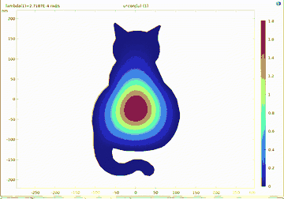
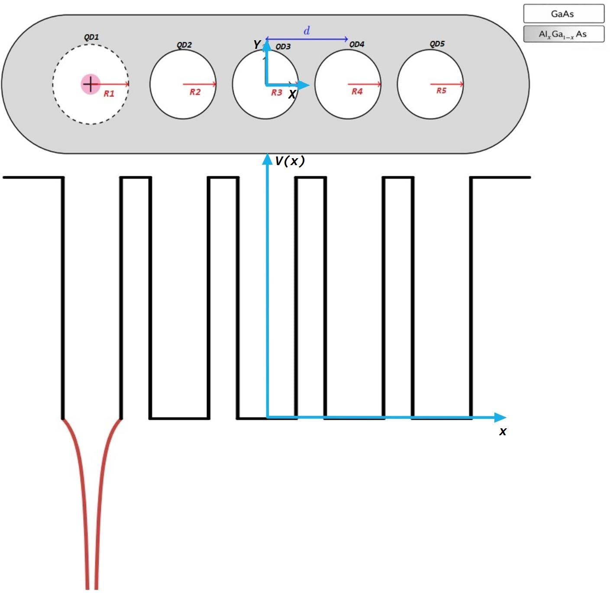
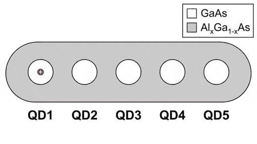
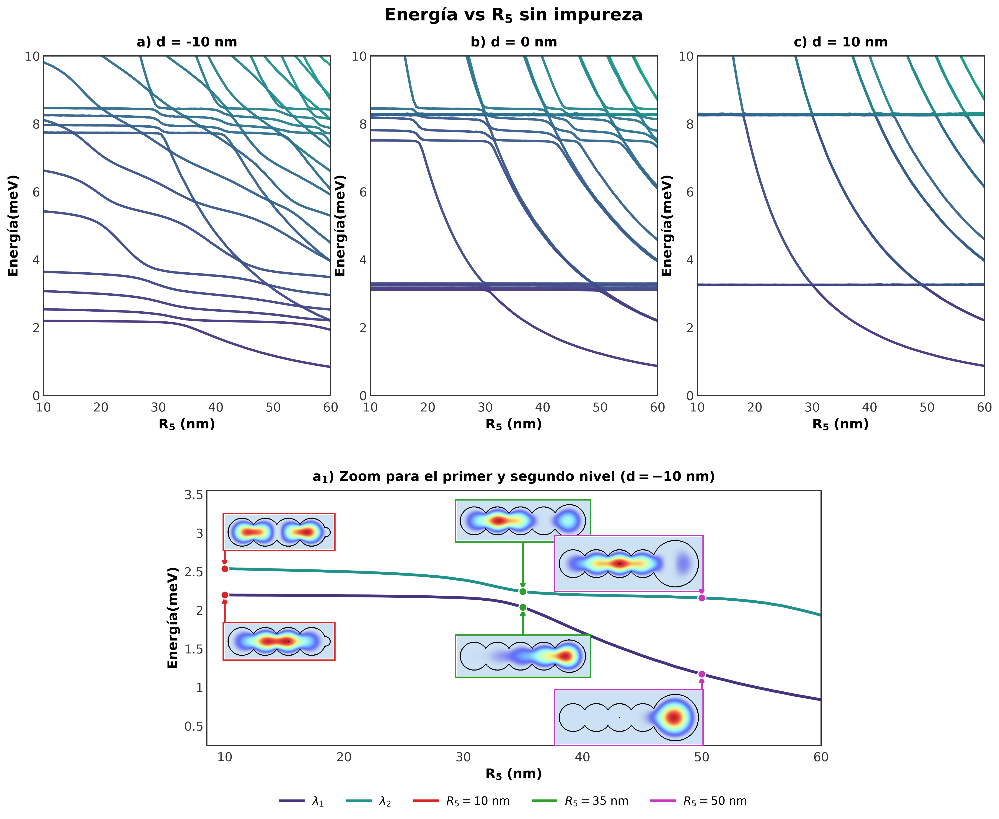
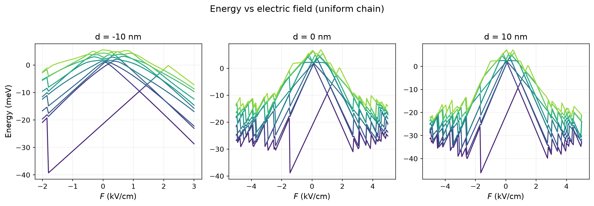

<div align="center">

# Five quantum dots, one impurity, and a field

### How a single donor rewrites the spectrum of a quantum dot chain

[](https://www.python.org/)
[](https://www.comsol.com/)
[](https://numpy.org/)
[](LICENSE)
[](figures/LICENSE)
[](https://github.com/danielparra2)

**BSc Physics thesis · Universidad Industrial de Santander (UIS) · 2026**

</div>

---

## 1. Motivation

A quantum dot is a nanostructure that confines a charge carrier in all three spatial dimensions. In a chain of five laterally coupled GaAs/AlGaAs dots, an electron can tunnel between them through thin AlGaAs barriers. The central question of this thesis is:

> *What additional effect does a donor impurity have on the chain spectrum, and which interaction dominates — quantum confinement or the Coulomb potential of the impurity?*

<p align="center">
  
</p>

<p align="center">
  <sub><b>Localization.</b> The probability density follows the impurity as it moves along the chain axis (COMSOL, uniform chain, d = 0 nm).</sub>
</p>

<details>
<summary><b>Easter egg: Michin, the quantum cat</b> (click)</summary>
<p align="center">
  <br>
  <sub>An electron could be confined in any geometry — including a cat. The real cat is named Michin.</sub>
</p>
</details>

---

## 2. The system

<p align="center">
  
</p>

Five circular GaAs dots of radius R = 30 nm embedded in an Al<sub>0.3</sub>Ga<sub>0.7</sub>As matrix. A donor impurity sits at position x<sub>i</sub> along the chain axis. The parameter d is the inter-dot gap (d = 0 → touching dots, d = 10 nm → 10 nm gap). The in-plane Hamiltonian in the effective-mass approximation is:

$$
\hat H = -\frac{\hbar^2}{2m^*}\nabla^2
\;+\; V_{\text{conf}}(\mathbf r)
\;-\; \frac{e^2}{4\pi\varepsilon_0\varepsilon_r\,|\mathbf r-\mathbf r_i|}
\;+\; e\,\mathbf F\cdot\mathbf r .
$$

**Material and numerical parameters**

| Parameter | Value | Description |
|---|---|---|
| m* | 0.067 m₀ | Effective mass in GaAs |
| εᵣ | 12.9 | Relative permittivity in GaAs |
| x_Al | 0.3 | Al mole fraction |
| ΔEc | 213.84 meV | Conduction-band offset |
| a* | 10.19 nm | Effective Bohr radius |
| Ry* | 5.478 meV | Effective Rydberg |

Solved with 2D finite elements (COMSOL), quadratic Lagrange elements on an unstructured triangular mesh with geometric refinement towards the donor. Generalized eigenvalue problem `K u = E M u`, shift-invert solver. Validation against the exact 2D donor: **≤ 0.008 meV**. The same problem was independently cross-checked with a from-scratch FEM code: [`2d-hydrogen-atom-hydrogenic-impurity`](https://github.com/danielparra2/2d-hydrogen-atom-hydrogenic-impurity).

The full method, mesh strategy and export procedure are in [`docs/metodo.md`](docs/metodo.md).

---

## 3. Effect of impurity position (uniform chain)

The uniform chain (all five dots of radius R = 30 nm, equal gaps d) is scanned with the impurity at position x<sub>i</sub> along the chain axis.

<p align="center">
  
</p>

<p align="center">
  <sub><b>Energy vs impurity position.</b> First ten eigenvalues vs x<sub>i</sub> for d = −10, 0 and 10 nm (from <code>data/eigenvalues.csv</code>). The ground state is pinned near <b>−21.41 meV</b>, close to the isolated 2D donor (−21.90 meV): <b>Coulomb wins over confinement</b>. The inset resolves the sub-meV oscillations.</sub>
</p>

<p align="center">
  
</p>

<p align="center">
  <sub><b>Donor or acceptor?</b> The fifth dot fights for the electron. Its size decides who wins.</sub>
</p>

---

## 4. Effect of non-uniformity, no impurity

The first four dots keep R = 30 nm; the fifth dot has radius R<sub>5</sub>, which scans from 10 to 60 nm. No impurity is present. The data are in `data/eigenvalues.csv`.

<p align="center">
  
</p>

<p align="center">
  <sub><b>Non-uniform chain, no impurity.</b> Two features dominate: sub-band formation and the avoided crossing at R<sub>5</sub> ≈ 35 nm (Von Neumann–Wigner). At R<sub>5</sub> = 30 nm the fifth level joins the first sub-band. For R<sub>5</sub> &lt; 30 nm QD5 acts as a donor; for R<sub>5</sub> &gt; 30 nm it acts as an acceptor.</sub>
</p>

<p align="center">
  
</p>

---

## 5. Effect of electric field

An electric field F is applied along the chain axis. The ground state changes character at an anticrossing (localization transition). Data in `data/eigenvalues.csv`.

<p align="center">
  
</p>

<p align="center">
  <sub><b>The thesis in one loop.</b> The battery applies the field; the devil drags the electron across the chain; the induced dipole flips. The curves behind the cartoon are the real COMSOL simulation.</sub>
</p>

<p align="center">
  
</p>

<p align="center">
  <sub><b>Energy vs electric field (uniform chain).</b> The critical field is <b>inversely proportional to d</b>: 1.2 → 1.0 → 0.8 kV/cm for d = −10 → 0 → 10 nm. A more separated chain is easier to polarize — the opposite of the naive expectation.</sub>
</p>

---

## 6. Run it

```bash
pip install -r requirements.txt
python scripts/make_figures.py     # regenerate the five figures
jupyter lab notebooks/analysis.ipynb
```

No FEM is re-run. The notebook and the figure script read the single tidy table
`data/eigenvalues.csv`, which already contains every sweep, mode and eigenvalue.

| Notebook | What it does |
|---|---|
| [`analysis.ipynb`](notebooks/analysis.ipynb) | The three effects of the thesis, step by step |

**Data layout**

| File | Contents |
|---|---|
| `data/eigenvalues.csv` | One row per eigenvalue: `effect`, `chain`, `d_nm`, `R5_nm`, `xi_nm`, `sweep`, `sweep_value`, `sweep_unit`, `mode`, `E_eV`, `source_file` (18 exports, 117,335 rows) |
| `data/manifest.csv` | COMSOL model, version and export date for each of the 18 source files |

The tidy table is built from the original COMSOL exports; the raw `.txt` files
are not included in the repository. [`data/manifest.csv`](data/manifest.csv)
keeps the provenance of every source file.

---

## 7. Full manuscript

The complete manuscript (derivations, COMSOL method, extended results) is in [`Tesis-Pregrado-UIS-Puntos-Cuanticos`](https://github.com/danielparra2/Tesis-Pregrado-UIS-Puntos-Cuanticos).

---

## 8. Limitations

- The model is two-dimensional (in-plane), with a circular domain and a fixed
  effective mass `m* = 0.067 m0` and permittivity `εr = 12.9` for GaAs.
- The Hamiltonian uses the effective-mass approximation; band non-parabolicity
  and the full AlGaAs barrier are not included.
- The eigenvalues are the existing COMSOL exports. The FEM is not re-run by the
  notebooks, and the `.mph` models are not part of this repository.
- The critical field and the dipole plateaus come from a two-line fit around
  the anticrossing; they are estimates for the exported parameter ranges.

---

## 9. Citation and license

If you use this material, please cite it via [`CITATION.cff`](CITATION.cff).

- **Code:** MIT — see [`LICENSE`](LICENSE).
- **Original figures and animations:** CC BY 4.0 — see [`figures/LICENSE`](figures/LICENSE).
- Third-party cartoon stills used as analogies in the defense are included for context only and are not covered by the CC BY license.

<div align="center">

**Built with COMSOL Multiphysics + Python (NumPy, pandas, Matplotlib).**  
**Author:** [Daniel Parra Parra](https://github.com/danielparra2) · sasukeda25@gmail.com

</div>
