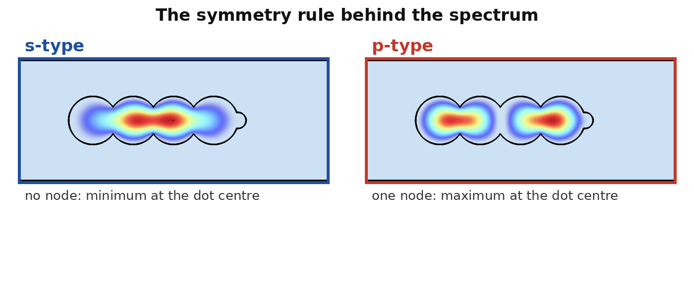
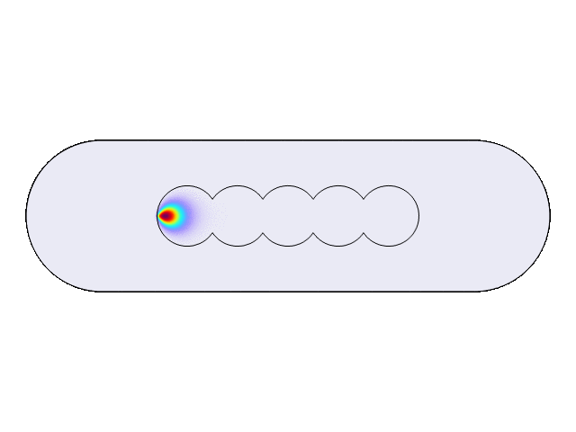
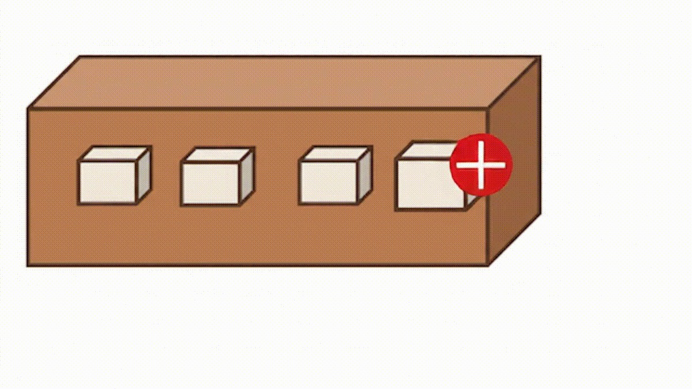
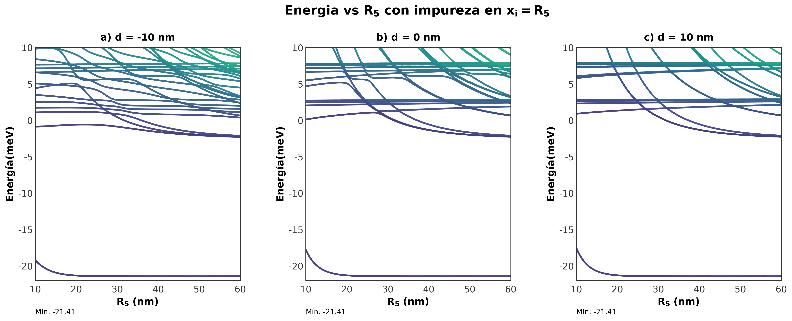

<div align="center">

# Five quantum dots, one impurity, and a field

### How a single donor rewrites the spectrum of a quantum dot chain

[](https://www.python.org/)
[](https://www.comsol.com/)
[](https://numpy.org/)
[](LICENSE)
[](figures/LICENSE)
[](https://github.com/danielparra2)

**BSc Physics thesis · Universidad Industrial de Santander (UIS) · 2026**

</div>

<p align="center">
  
</p>

<p align="center">
  <sub><b>The spectrum that started the thesis.</b> Energy of the first ten states versus the impurity position
  x<sub>i</sub>, for d = -10, 0 and 10 nm. The inset resolves the sub-meV oscillations of the ground state.
  Red dots mark x<sub>i</sub> = -110, 0 and 25 nm.</sub>
</p>

<p align="center">
  
</p>

<p align="center">
  <sub><b>The thesis in one loop.</b> A battery applies an electric field; the little devil pulls the electron
  across the chain; the induced dipole flips. The cartoon is from the defense — the curves behind it are the real
  COMSOL simulation. <a href="docs/animations.md">All animations →</a></sub>
</p>

> [!TIP]
> **The thesis in one sentence**
> In a chain of five coupled quantum dots, a single donor impurity barely changes the ground-state energy
> (≈ **−21.41 meV**, versus **−21.90 meV** for the isolated 2D donor) — yet it controls the symmetry, the
> localization and the field response of every excited state.

---

## The result that breaks intuition

<p align="center">
  
</p>

The spectrum follows a simple **symmetry rule**, and the rule is what makes the physics surprising:

| State | Shape | At the centre of a dot | At the bottleneck between dots |
|---|---|---|---|
| **s-type** | no node | **minimum** | maximum |
| **p-type** | one node | **maximum** | **minimum** |

The p-type state has a **nodal plane** in the middle. When the impurity sits at a bottleneck, the node fits
naturally into the constriction: each lobe occupies a neighbouring cavity and the energy drops. When the
impurity sits at the centre of a dot, both lobes are forced into the same cavity and the energy rises.
This is why the first excited state oscillates **out of phase** with the ground state in the figure above.

**Four counterintuitive numbers**

| Observation | Value | Why it matters |
|---|---|---|
| Ground state of the chain | **−21.41 meV** | Almost identical to the isolated donor (−21.90 meV): **Coulomb wins over confinement** |
| Critical field vs separation | **1.2 → 1.0 → 0.8 kV/cm** for d = −10 → 0 → 10 nm | A **more separated** chain needs **less** field to polarize — the opposite of the naive expectation |
| Dipole hierarchy | `abs(p₁) < abs(p₂)` in the symmetric chain | Structural asymmetry can **invert** it (`R₅ = 50 nm`) |
| Fifth dot | **donor** for `R₅ < 30 nm`, **acceptor** for `R₅ > 30 nm` | A geometric knob that changes the sign of the charge transfer |

And one more, hidden in the curves: when two states share the same symmetry, their levels **never cross**.
They repel. That is the **Von Neumann–Wigner anticrossing** around `R₅ = 35 nm` in
[`figures/EvsR5_noImpureza_orbitales.png`](figures/EvsR5_noImpureza_orbitales.png).

---

## Watch the physics

<table>
<tr>
<td width="50%" align="center">
  <br>
  <sub><b>Localization.</b> The probability density follows the impurity as it moves along the chain
  (COMSOL, uniform chain).</sub>
</td>
<td width="50%" align="center">
  <br>
  <sub><b>Donor or acceptor?</b> The fifth dot fights for the electron. Its size decides who wins.</sub>
</td>
</tr>
</table>

<table>
<tr>
<td width="50%" align="center">
  <br>
  <sub><b>The magnifying-glass analogy.</b> Finding the impurity is a localization problem.</sub>
</td>
<td width="50%" align="center">
  <br>
  <sub><b>Dimensionality, the cartoon version.</b> From bulk to a zero-dimensional dot: fewer dimensions,
  more quantum behaviour.</sub>
</td>
</tr>
</table>

<details>
<summary><b>Easter egg: Michin, the quantum cat</b> (click)</summary>
<p align="center">
  <br>
  <sub>A cat-shaped eigenmode. Because why not. The real cat is named Michin.</sub>
</p>
</details>

---

## The system

<p align="center">
  
</p>

Five circular GaAs dots embedded in an Al<sub>0.3</sub>Ga<sub>0.7</sub>As matrix. A donor impurity sits at
position `x_i` along the chain axis. The in-plane Hamiltonian in the effective-mass approximation is

$$
\hat H = -\frac{\hbar^2}{2m^*}\nabla^2
\;+\; V_{\text{conf}}(\mathbf r)
\;-\; \frac{e^2}{4\pi\varepsilon_0\varepsilon_r\,|\mathbf r-\mathbf r_i|}
\;+\; e\,\mathbf F\cdot\mathbf r .
$$

<table>
<tr>
<td width="50%">

**Material parameters**

| Parameter | Value |
|---|---|
| `m*` (GaAs) | `0.067 m₀` |
| `εr` (GaAs) | `12.9` |
| `x_Al` | `0.3` |
| `ΔEc` | `213.84 meV` |
| `a*` | `10.19 nm` |
| `Ry*` | `5.478 meV` |

</td>
<td width="50%">

**Numerical method**

- 2D finite elements (COMSOL), quadratic Lagrange elements.
- Unstructured triangular mesh with geometric refinement towards the donor.
- Dirichlet boundary at `R = 200 nm`; finite-size check at `R = 300 nm`.
- Generalized eigenvalue problem `K u = E M u`, shift-invert solver.
- Validation against the exact 2D donor: **≤ 0.008 meV**.

</td>
</tr>
</table>

The full method, the mesh strategy and the export procedure are in
[`docs/metodo.md`](docs/metodo.md).

---

## Results

<table>
<tr>
<td width="50%" align="center">
  <br>
  <sub><b>Non-uniform chain.</b> Sub-bands, avoided crossings and the orbital character at
  R<sub>5</sub> = 10, 35 and 50 nm.</sub>
</td>
<td width="50%" align="center">
  <br>
  <sub><b>Induced dipole.</b> Two well-defined polarization regimes separated by a sharp jump at the
  critical field.</sub>
</td>
</tr>
<tr>
<td width="50%" align="center">
  <br>
  <sub><b>Energy vs field.</b> The anticrossing moves to lower fields as the dots separate.</sub>
</td>
<td width="50%" align="center">
  <br>
  <sub><b>Asymmetry matters.</b> With the donor at the fifth dot, the edge is no longer equivalent to the
  centre.</sub>
</td>
</tr>
</table>

The complete figure set is indexed in [`docs/figuras.md`](docs/figuras.md).

---

## Data and reproducibility

**32 COMSOL exports** (8.3 MB) with their original headers:

```
% Model:    qd5=10_d=0.mph
% Version:  COMSOL 6.4.0.429
% Date:     Aug 23 2026, 12:19
% Nodes:    4020
...
```

| Family | Files | What it scans |
|---|---|---|
| Uniform chain, energy vs `x_i` | `caso1/2/3.txt` | `x_i` for `d = -10, 0, 10 nm` |
| Uniform chain, energy vs field | `c1_F, c2_2_F, c3_F.txt` | `F` from −2 to 10 kV/cm |
| Non-uniform chain, no impurity | `EvsR5sind*.txt` | `R₅` for three `d` |
| Impurity at `x_i = 0, R₁, R₅` | `EvsR5xi=*.txt` | `R₅` |
| Fixed `R₅ = 10, 50 nm` | `EvsxiR5=*.txt` | `x_i` |
| Asymmetric chain, dipole | `AEvsF_R10/R50*.txt` | `F` for `R = 10, 50 nm` |

Every file is mapped to its COMSOL model, version and export date in
[`data/manifest.csv`](data/manifest.csv). The raw exports are **not merged**: the per-file header is the
provenance. If you need one table, run `python scripts/consolidar.py`.

**Notebooks**

| Notebook | What it does |
|---|---|
| [`01_data_pipeline.ipynb`](notebooks/01_data_pipeline.ipynb) | Reads the exports, sorts eigenvalues into modes, explains units and pitfalls |
| [`02_results_figures.ipynb`](notebooks/02_results_figures.ipynb) | Rebuilds the final thesis figures step by step |
| [`03_dipole_analysis.ipynb`](notebooks/03_dipole_analysis.ipynb) | Extracts `p₁`, `p₂` and the critical field |

```bash
python -m venv .venv && source .venv/bin/activate
pip install -r requirements.txt
jupyter lab notebooks/01_data_pipeline.ipynb
```

No FEM is re-run. The notebooks only read the existing exports and plot.

---

## Thesis at a glance

| | |
|---|---|
| **Title** | *Effect of a donor impurity on the optoelectronic properties of a linear quantum dot chain* |
| **Author** | Daniel Parra Parra |
| **Director** | Willian Gutiérrez Niño |
| **Institution** | Universidad Industrial de Santander (UIS), Bucaramanga, Colombia |
| **Year** | 2026 |
| **Grade** | **5.0 — Laureate thesis** |
| **Keywords** | coupled quantum dots · donor impurity · electron localization · structural asymmetry · optoelectronic response |
| **Manuscript** | Kept in a separate repository; available on request. |

## Repository layout

```
quantum-dot-chain-impurity/
├── data/                 32 COMSOL exports + manifest.csv
├── notebooks/            01 data pipeline · 02 figures · 03 dipole analysis
├── figures/              final figures, auxiliary orbital images, animations, analogies
├── scripts/              manifest builder, consolidator, mesh schematic
├── docs/                 method · figure index · animations · defense notes
├── requirements.txt      numpy · scipy · pandas · matplotlib · jupyterlab
├── CITATION.cff
└── LICENSE
```

---

## Citation and license

If you use this material, please cite it via [`CITATION.cff`](CITATION.cff).

- **Code:** MIT — see [`LICENSE`](LICENSE).
- **Original figures and animations:** CC BY 4.0 — see [`figures/LICENSE`](figures/LICENSE).
- Third-party cartoon stills used as analogies in the defense are included for context only; they are not
  covered by the CC BY license.

<div align="center">

**Built with COMSOL Multiphysics + Python (NumPy, pandas, Matplotlib).**
**Author:** [Daniel Parra Parra](https://github.com/danielparra2) · sasukeda25@gmail.com

</div>
