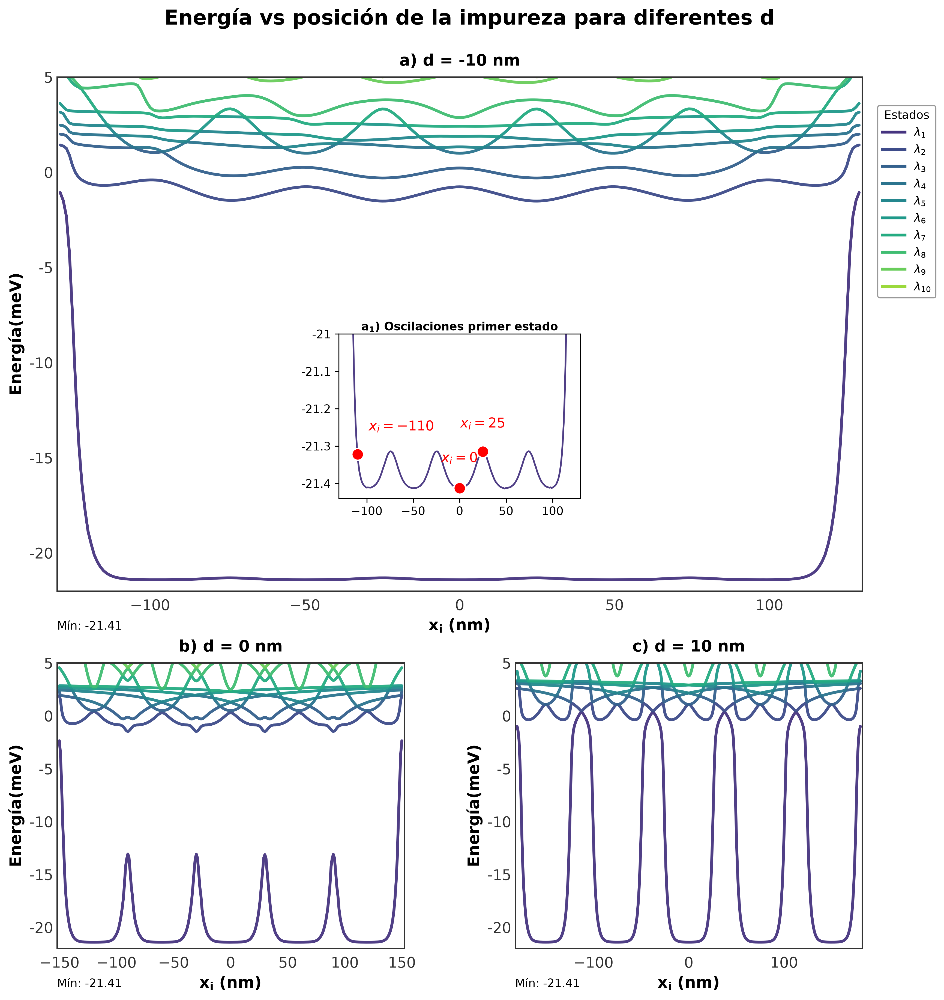
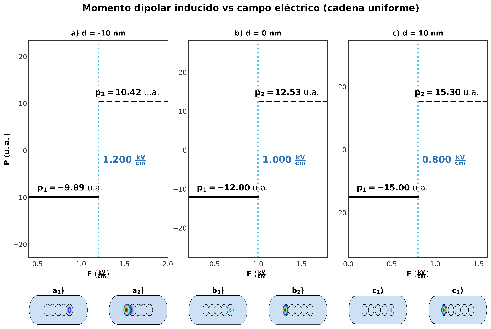
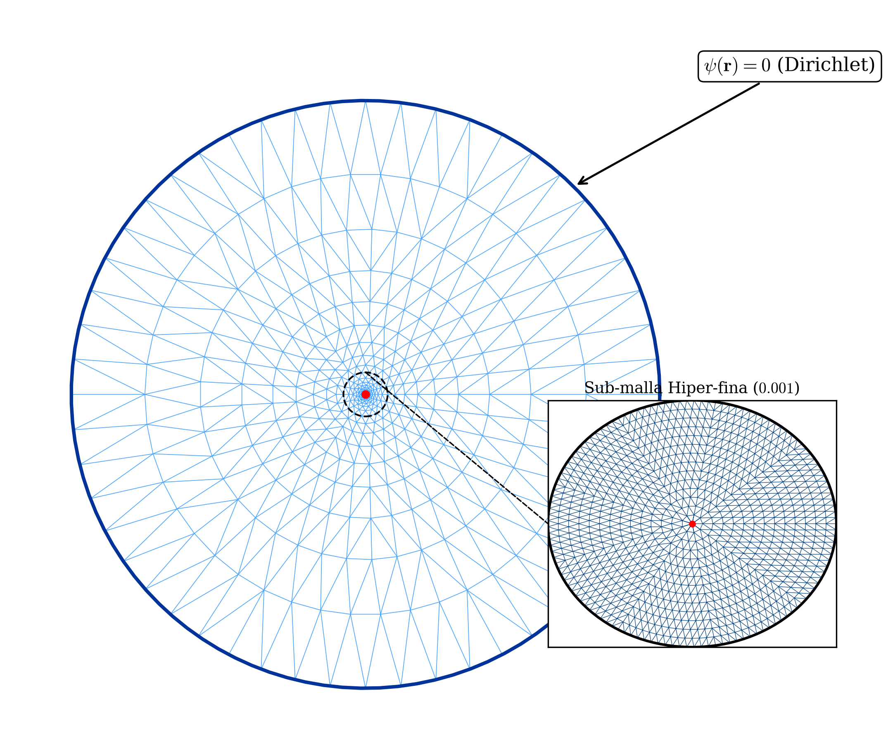

<div align="center">

# Quantum dot chain with a donor impurity

### FEM simulation of a five-dot GaAs/AlGaAs chain under an electric field

[](https://www.python.org/)
[](https://www.comsol.com/)
[](https://numpy.org/)
[](LICENSE)
[](https://github.com/danielparra2)

**BSc Physics thesis · Universidad Industrial de Santander (UIS) · 2026**

</div>

<p align="center">
  
</p>

<p align="center">
  <sub><b>Energy vs impurity position</b> for three inter-dot separations (d = -10, 0, 10 nm). The inset resolves the
  sub-meV oscillations of the ground state; red dots mark the impurity at x<sub>i</sub> = -110, 0 and 25 nm.</sub>
</p>

---

## What is this?

A donor impurity is placed inside a **linear chain of five laterally coupled quantum dots**
(GaAs dots embedded in an Al<sub>0.3</sub>Ga<sub>0.7</sub>As matrix). The repository contains the
raw COMSOL exports, the Python/Jupyter analysis, and the final figures of the thesis:

> **Effect of a donor impurity on the optoelectronic properties of a linear quantum dot chain.**

The central question: *how does the position of the impurity, the inter-dot separation, and an
external electric field reshape the energy spectrum and the induced dipole of the chain?*

## Physics in one minute

Within the **effective-mass approximation**, the electron feels the quantum-dot confinement, the
screened Coulomb attraction of the donor, and the external field:

$$
\hat H = -\frac{\hbar^2}{2m^*}\nabla^2
\;+\; V_{\text{conf}}(\mathbf r)
\;-\; \frac{e^2}{4\pi\varepsilon_0\varepsilon_r\,|\mathbf r-\mathbf r_i|}
\;+\; e\,\mathbf F\cdot\mathbf r .
$$

- GaAs parameters: `m* = 0.067 m0`, `εr = 12.9`, `ΔEc = 213.84 meV` for `x_Al = 0.3`.
- Isolated 2D hydrogenic donor: `E_n = -Ry*/(n+1/2)²`, with `Ry* ≈ 5.478 meV`.
- The numerical model reproduces this limit to **≤ 0.008 meV**, validating the FEM pipeline.

## Results

<table>
<tr>
<td width="50%" align="center">
  <br>
  <sub><b>Non-uniform chain.</b> Levels vs inter-dot distance R<sub>5</sub>, with FEM orbitals at the
  avoided crossings.</sub>
</td>
<td width="50%" align="center">
  <br>
  <sub><b>Induced dipole.</b> Two well-defined polarization regimes separated by a sharp jump at the
  anticrossing field.</sub>
</td>
</tr>
<tr>
<td width="50%" align="center">
  <br>
  <sub><b>Energy vs electric field</b> for the uniform chain (d = -10, 0, 10 nm).</sub>
</td>
<td width="50%" align="center">
  <br>
  <sub><b>Multiscale mesh.</b> Geometric refinement towards the donor and Dirichlet boundary at R = 200 nm.</sub>
</td>
</tr>
</table>

**Takeaways**

| Observation | Value |
|---|---|
| Ground state of the chain | ≈ **-21.41 meV**, close to the isolated donor (-21.90 meV) |
| Coulomb vs confinement | The donor dominates; structure effects appear at the chain ends and at material changes (d = 0, 10 nm) |
| Field response | Two polarization branches: `p1 ≈ -15` → `p2 ≈ +15` (a.u.) across the anticrossing |
| FEM vs analytic validation | **≤ 0.008 meV** (2D hydrogenic limit) |

## Repository layout

```
quantum-dot-chain-impurity/
├── data/                 32 COMSOL exports (.txt) + manifest.csv
├── notebooks/
│   ├── 01_analisis_exploratorio.ipynb   reading, eigenvalue sorting, dipole analysis
│   └── 02_figuras_tesis.ipynb           final thesis figures
├── figures/              final PNGs + auxiliary orbital images
│   └── aux/{von_neumann,momento}/
├── scripts/
│   ├── malla_dominio.py           schematic of the multiscale mesh
│   ├── generar_manifest.py        rebuild data/manifest.csv from COMSOL headers
│   └── consolidar.py              optional single-file consolidated dataset
├── docs/
│   ├── metodo.md           model, parameters, mesh and COMSOL export procedure
│   ├── figuras.md          figure ↔ thesis result map
│   └── parametros_comsol.txt
├── requirements.txt
├── CITATION.cff
└── LICENSE
```

## Data provenance

Every `.txt` file is a **direct export from COMSOL Multiphysics** and keeps its original header:

```
% Model:    qd5=10_d=0.mph
% Version:  COMSOL 6.4.0.429
% Date:     Aug 23 2026, 12:19
% Dimension: 1
% Nodes:    4020
...
```

The mapping **file → COMSOL model → version → export date → physical case** is in
[`data/manifest.csv`](data/manifest.csv). The 32 exports cover:

| Family | Files | What it scans |
|---|---|---|
| Uniform chain, energy vs impurity position | `caso1/2/3.txt` | `x_i` for `d = -10, 0, 10 nm` |
| Uniform chain, energy vs field | `c1_F, c2_2_F, c3_F.txt` | `F` from -2 to 10 kV/cm |
| Non-uniform chain, no impurity | `EvsR5sind*.txt` | `R_5` for three `d` |
| Non-uniform chain, impurity at `x_i = 0, R_1, R_5` | `EvsR5xi=*.txt` | `R_5` |
| Non-uniform chain, fixed `R_5` | `EvsxiR5=*.txt` | `x_i` for `R_5 = 10, 50 nm` |
| Asymmetric chain, dipole | `AEvsF_R10/R50*.txt` | `F` for `R = 10, 50 nm` |

> `X` is stored in **meters** for position scans and in **kV/cm** for field scans, exactly as the
> notebooks expect. No post-processing was applied to the raw files.

## Run it

```bash
python -m venv .venv && source .venv/bin/activate
pip install -r requirements.txt
jupyter lab notebooks/02_figuras_tesis.ipynb
```

The notebooks are self-contained and write their figures to `figures/`. Outputs were stripped
from the committed notebooks to keep the repository light; the rendered figures are included.

To rebuild the COMSOL metadata table after adding new exports:

```bash
python scripts/generar_manifest.py
```

## Method & validation

The numerical method, mesh strategy, boundary conditions and extraction procedure are documented
in [`docs/metodo.md`](docs/metodo.md). The FEM model was validated against the exact 2D hydrogenic
donor before being applied to the chain — the same atom solved from scratch with an in-house
P2 finite-element code is available in
[`hydrogenic-atom-2d-fem`](https://github.com/danielparra2/hydrogenic-atom-2d-fem).

## Author

**Daniel Parra Parra** — Computational physicist, Universidad Industrial de Santander (UIS).
Laureate thesis (5.0, 2026). Interests: AI for Science, numerical methods, quantum systems.

- GitHub: [@danielparra2](https://github.com/danielparra2)
- Email: [sasukeda25@gmail.com](mailto:sasukeda25@gmail.com)

If you use this material, please cite it via [`CITATION.cff`](CITATION.cff).

## License

Released under the **MIT License** — see [`LICENSE`](LICENSE).
